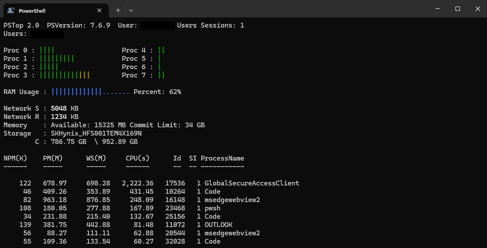

# StartPSTop
Inspiration from various terminal monitoring tools. Made completely with PowerShell.

Install process: </br>
</br>
Copy Files </br>
Unblock file with PowerShell </br>
&emsp;```PS > Unblock-File <Path to directory>\Start-PSTop.psm1``` </br>
</br>
Copy folder (Start-PSTop) to a path from $env:PSModulePath
</br>


